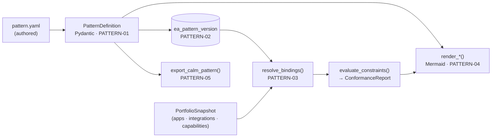

# PATTERN bundle — Enterprise Architecture Patterns-as-Code

**Bundle:** PATTERN-01 → PATTERN-05
**Package:** `adp.patterns` (new sibling package)
**Status:** draft
**Date:** 2026-11-14

## What

A typed, versioned, executable way to capture **Enterprise Architecture patterns** in ADP. Patterns are written as YAML, validated into a Pydantic model, persisted with lifecycle, **evaluated against the live ADP registry** (conformance + anti-pattern discovery), and **rendered to Mermaid** as derived views. Reference-architecture patterns can optionally be exported to FINOS CALM for solution architects.

## Why

ADP's knowledge base holds patterns as searchable prose. That repeats the problem ADP exists to fix: a hand-maintained artifact that drifts away from the estate it describes. An EA pattern is mostly a **rule over the portfolio** ("no cross-domain point-to-point", "one system of record per capability"), not a single topology. Encoding it as roles + relationships + constraints makes conformance a **derived, queryable fact**, in the same way compliance status and evolution stage are derived.

**Why not CALM as the source format:** CALM patterns are JSON Schema templates. They pin nodes by `unique-id` and position (`prefixItems`) and validate one architecture document at a time. EA needs abstract **role binding**, **constraints that range over the whole portfolio**, **transitions/plateaus**, and **anti-pattern discovery**. CALM stays an *export target* (PATTERN-05).

## Core concept

An EA pattern = **Roles** (abstract slots bound to registry entities) + **Relationships** (typed edges between roles) + **Constraints** (CEL predicates evaluated over bound elements) + **Motivation** (principles, controls, forces) + optional **Transition** (plateaus that are reached when listed constraints pass).

One definition runs in three modes:

| Mode | Question | Spec |
|---|---|---|
| Template | What should this look like? | PATTERN-04 (structure view), PATTERN-05 (CALM scaffold) |
| Conformance | Does this scope obey the pattern? | PATTERN-03 |
| Discovery | Where does this anti-pattern occur in the estate? | PATTERN-03 |

## Specs

| Spec | Title | Migration | Models | Store | Router | Depends on |
|---|---|---|---|---|---|---|
| PATTERN-01 | Pattern metamodel & YAML format | — | ✔ | — | — | — |
| PATTERN-02 | Pattern registry & lifecycle | ✔ | ✔ | ✔ | ✔ | 01 |
| PATTERN-03 | Binding & conformance engine | ✔ | ✔ | ✔ | ✔ | 01, 02 |
| PATTERN-04 | Mermaid viewpoint rendering | — | ✔ | — | ✔ | 01 (03 for conformance/transition views) |
| PATTERN-05 | CALM export | — | ✔ | — | ✔ | 01 |

## Data flow

## Bundle-wide constraints (existing ADP conventions)

- Pydantic v2, `model_config = ConfigDict(extra="forbid")` on every boundary model.
- Composite-PK join tables with `ON DELETE CASCADE`.
- Named CHECK constraints only in Alembic migrations; store layer uses Core `Table()` objects with no FK/PK/CHECK.
- Route-prefix → `ActionType` permission mapping via middleware; the completeness test must cover every new mutating route.
- All status derivation (conformance status, plateau reached, binding resolution) is done in **pure functions** and **derived on read, never stored**.
- Pure engine functions must be runnable and validated in isolation against fixtures before full delivery.
- Lifecycle vocabulary reuses ADP's existing `draft → proposed → current → deprecated → decommissioned`.

## Bundle-wide out of scope

- Patterns owned by non-EA roles (Solution, Technical, Security, Infrastructure, Identity). The `owner_role` field exists so they can be added later, but only `owner_role: enterprise` is accepted in this bundle.
- AI-generated or AI-suggested patterns (would require the AI-proposes/human-confirms gate; future spec).
- Pattern variants / option groups (CALM-style `oneOf` choices).
- Mermaid diagram types other than `flowchart`.
- Importing CALM, ArchiMate, or Structurizr into patterns.
- Frontend screens beyond what the existing Knowledge/Diagrams surfaces can render from the API.

## Bundle-level open questions

| # | Question | Where it bites |
|---|---|---|
| OQ-B1 | **Source of truth:** is git-held YAML canonical (DB is a projection, import on merge) or is the DB canonical (YAML is export via `adp.export`)? The spec supports both directions with digest-based idempotency but does not pick. | PATTERN-02 |
| OQ-B2 | **Anti-patterns:** a separate `kind` with `polarity: detect` constraints (the spec's default), or the negation of a positive pattern? | PATTERN-01, 03 |
| OQ-B3 | **Binding model:** must a pattern be explicitly *applied* to a scope before evaluation, or may it be evaluated across the whole portfolio implicitly? (The spec's default: explicit application for conformance, implicit only for anti-pattern discovery.) | PATTERN-03 |
| OQ-B4 | Should the existing `adp.knowledge` pattern items be migrated or linked to `ea_pattern`, or should the two coexist? | PATTERN-02 |

---

## Addendum — ADP review (2026-11-14)

Reviewed against the ADP codebase at migration head `043`. Tracked as epic **ADP-mmm** (specs 934–937: ADP-mmm.1 … ADP-mmm.4). Where this addendum and the sections above disagree, the addendum wins.

### Decisions confirmed with the user (2026-11-14)
- **OQ-B1:** the DB is canonical. YAML comes in through the API and goes out through `adp.export`.
- **OQ-B4:** each pattern family is also written into the knowledge base as one `knowledge_items` row. The existing prose patterns are kept.
- **Spec split:** 4 vertical specs (934–937).
- **UI:** each spec ships its own screens.

### What the bundle gets right (keep)
- **Derived on read, never stored.** Conformance status and plateau are computed from pure functions, mirroring `compute_compliance_status()` (`adp.compliance.store`) and `compute_status()` (`adp.strategy.store`). The "no status column" guard test is a good idea.
- **Pure engine validated against fixtures before any DB work** (the COMPLY-03 precedent).
- **Storage:**
  - immutable JSONB `definition` per version;
  - a family/version split;
  - a partial unique index for "one current";
  - digest-based idempotent import.
- **"Adoption", not "application".** The naming collision is real.
- **CALM is an export target, not the source; Mermaid is a render target, not the source.** Both judgements are right.
- **Explicit loss report** on CALM export; `field_unavailable` instead of a false pass/fail for gated fields.

### Ground-truth corrections (the bundle assumes things ADP doesn't have)
| # | Bundle assumes | Reality | Fix |
|---|---|---|---|
| G1 | `application.domain_id` | No domain FK. `owning_business_unit` is free text. The domain is reachable only via `application_capability_links → business_capabilities.domain_id` (many-to-many, so an app can sit in **several** domains) or `application_domain_integrations` | The snapshot derives `domain_ids: list` per app on read (no migration). "Cross-domain integration" = source and target domain sets are disjoint (define it explicitly; apps with no domain → `unknown`) |
| G2 | `time_disposition` (lowercase), `r7_disposition`, `tags`, `technology_standard_status`, `risk_rating`, `annual_cost` | `time_classification` (Tolerate/Invest/Migrate/Eliminate, title case), `r_strategy`. No general tags (only `tech_debt_flags`, regulatory tags). No tech-standard status. Risk is a separate table (`security_posture`, `data_classification`…). Cost is a separate table whose TCO is computed on read | Rebuild the snapshot attribute table from `adp.application.models`. Gated attributes = `application_risk.*` (READ_APPLICATION_RISK), `application_cost.tco` (READ_APPLICATION_COST), governance (READ_APPLICATION_GOVERNANCE). The reference fixture's `backbone` selector must be rewritten (no `tags`). Options: pin the backbone, or use `architecture_pattern` / `integration_type == 'event'` |
| G3 | Integrations carry `protocol, style, mediator_id`, plus source/target domain | `application_integrations` = `source_app_id, target_app_id, integration_type (API/event/file/database/messaging/other), description` only | `publishes/consumes/delivers` collapse to "integration source→target, optionally filtered by `integration_type`". Mediation = app→backbone→app edges (no mediator column). Drop `protocol`/`style` |
| G4 | `technology_standard` ElementType | No technology-standards entity exists (only `element_technology_tags` on designs) | Drop it from `ElementType`. **Add `agent`** (933 agent registry) and consider `design` |
| G5 | Evidence for `serves`/`owns`/`realizes` "verify" | `serves` → `application_capability_links` (exists). `realizes` → `application_tech_cap_links` with `usage_type='provides'` (exists). `owns` → no source | Keep `serves` and `realizes` with real evidence. Drop `owns` (or leave it permanently `unverifiable`) — answers PATTERN-03 OQ-4 |
| G6 | Business domain `risk_classification`; capability `maturity` | `classification` (strategic/differentiating/commodity), `risk_flags[]`; `maturity_level` (1–5) | Rename in the snapshot table |
| G7 | Permissions v1.8.0 → 1.9.0; `PATTERN_WRITE`/`PATTERN_GOVERN` | Currently **1.10.0**. ActionType naming is verb-first (`WRITE_COMPLIANCE`, `AMEND_STANDARD`) | → 1.11.0, with `WRITE_PATTERN` / `GOVERN_PATTERN`; EA gets both by wildcard |
| G8 | "Read-only allowlist entry" for `POST /evaluate`, `POST /render` | No such allowlist. The completeness test (`tests/authz/test_enforcement.py:57`) requires every POST to map to an action (precedent: `POST /designs/{id}/validate` → explicit rule) | Map the dry-run POSTs explicitly to `WRITE_PATTERN` (they are authoring tools anyway) in `_EXPLICIT_ROUTE_ACTIONS` |
| G9 | Writes produce "audit entries" | `audit_entries` is tied to designs. Every domain package (compliance, strategy, business, agentic) uses actor-attributed `logger.info` lines | Follow that precedent: log actor, digest before/after, and the transition reason |
| G10 | `ea_pattern_control_link`, "ship only if COMPLY-01 merged" | COMPLY-01/02 are merged, and `control_pattern_mapping` (033) **already maps controls → `knowledge_items` of kind `pattern`**, with assessed status | Don't create a second pattern↔control table. Reuse `control_pattern_mapping` through the knowledge projection (below) |
| G11 | Mermaid validated with `@mermaid-js/mermaid-cli`; C4 theme "palette tokens" | Neither the backend nor the frontend uses the real Mermaid library. The web app renders with Canvas `diagram-core` (Mermaid-dialect parsers). `c4-theme.json` has per-kind hex values, not tokens | Target the **diagram-core flowchart dialect**: verify that `subgraph`, `classDef`/`class`, `-.-x`, `{{ }}`, `[/ /]` round-trip through its parser, and test the goldens with a vitest that parses them with the package (not mermaid-cli). Define a small named palette for the classes from existing hexes |
| G12 | "Importing CALM is out of scope" | ADP **already imports CALM** (`POST /api/v1/knowledge/import/calm`, `adp/api/routers/calm.py`) | PATTERN-05 should pin the same CALM release as the importer and share its mapping constants |
| G13 | Lifecycle "ADP vocabulary" | Designs use `draft, proposed, current, complete, deprecated, decommissioned`, with reset-to-draft from anywhere (`api/routers/lifecycle.py:27`) | The bundle's 5-state machine (no `complete`, no reset after `proposed`) is the right one for immutable versions; just say it intentionally differs |
| G14 | Migrations `NNNN` | Head = `043` | 044 registry, 045 adoption |

### Design issues beyond facts
1. **The knowledge-base overlap is the central decision (OQ-B4).**
   - `knowledge_items` already holds 7 patterns, 5 reference architectures and 6 principles, with a UI, embeddings, chat retrieval, CALM import and compliance mappings.
   - A parallel `ea_pattern` registry with no bridge would split "where patterns live".
   - Recommendation: every pattern family **projects into one `knowledge_items` row** (kind `pattern` / `reference_architecture`, `full_text` = name + summary + motivation, `source_ref = adp-pattern:<key>`), refreshed on promotion to `current`. That gives:
     - search, chat retrieval and `control_pattern_mapping` for free;
     - the existing prose patterns keep working;
     - they can later be converted one by one (out of scope for v1).
   - `ea_pattern.knowledge_item_id` holds the link.
2. **Data thinness.**
   - The seeded estate has 18 apps, few integrations, and many apps without capability links (so no domain).
   - Most reports will come out `not_applicable` or `indeterminate`. Conformance is only as good as the registry.
   - The engine spec needs seed patterns plus enough seed integrations and capability links to demo a real `non_conformant`.
   - The 50,000-evaluation limit is irrelevant at this scale; keep it, but don't spend effort measuring it.
3. **CEL is the biggest new-dependency risk.**
   - There is no expression library today.
   - Keep the adapter, and make the library spike (cel-python vs `common-expression-language` vs `cel-expr-python`, must run on Py 3.11) a **gating task in spec 1**, not an open question.
   - The spike must prove:
     - custom functions `role()` / `bound()`;
     - error positions;
     - cost limits;
     - missing-key behaviour on dicts (needed for `field_unavailable`).
4. **UI.**
   - The bundle defers the frontend.
   - Every ADP feature ships its screen. EAs won't author or adopt through curl.
   - Add a "Patterns" view in each spec (see below).
   - Rendered views go into the existing diagram canvas, and "Save as diagram" to `adp.diagrams` (flowchart type) is cheap (spec 048 precedent). That answers PATTERN-04 OQ-1: live view plus an optional snapshot save, with the provenance header marking staleness.
5. **Small spec fixes.**
   - `scope_ref UUID`: business domain ids are `String(36)`/TEXT across ADP; use TEXT.
   - Adoption-member FK → `applications.id`, TEXT.
   - The `uq_ea_pattern_adoption_scope` COALESCE needs a TEXT sentinel.
   - `known_implementations` should resolve to application ids at promotion (store check), not "in 03".
   - The PATTERN-01 `lifecycle` field in YAML is noise; drop it from the authored format rather than "ignore with warning".

### Proposed spec breakdown (speckit numbers 934+; the bundle's 5 docs regrouped into 4 vertical slices)
| Spec | Covers | Migration | UI |
|---|---|---|---|
| **934 pattern-metamodel** | PATTERN-01 + CEL library spike (gating) + G4/G5 enum corrections + generated schema via `adp-generate` | — | — (pure library + fixtures) |
| **935 pattern-registry** | PATTERN-02 + structure/catalog/traceability views from PATTERN-04 + knowledge projection (G10) + `adp.export` `patterns/<key>@<version>.yaml` (5th export task) + search via projection | 044 | Patterns nav view: catalog list/filter, version detail with YAML (Monaco/textarea) + live validation, lifecycle actions, structure/catalog views on the diagram canvas, import YAML |
| **936 pattern-conformance** | PATTERN-03 + conformance/transition views + snapshot rebuilt per G1–G6 + seed patterns (domain-event-backbone, point-to-point-mesh anti-pattern, one transition) + seed integrations/capability links | 045 | Adoptions tab: create adoption (domain/app set/portfolio), pins, conformance report (findings table + conformance diagram), discovery page for anti-patterns, "Save as diagram" |
| **937 pattern-calm-export** (optional, last) | PATTERN-05 aligned with the existing CALM importer (G12) | — | Export button on reference-architecture versions |

Follow-on beads, not specs now:
- Governance "at risk" rollup (PATTERN-03 OQ-6);
- conformance history;
- AI-drafted patterns;
- non-EA owner roles;
- converting the existing prose knowledge patterns.
