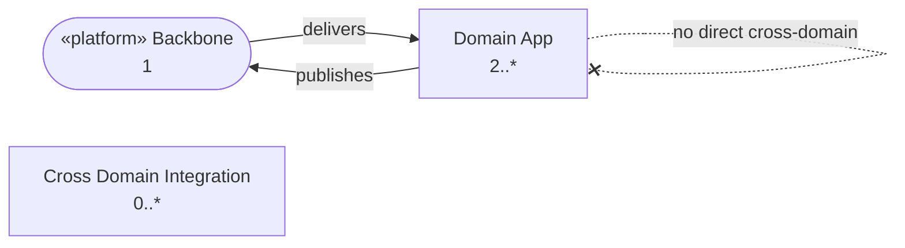
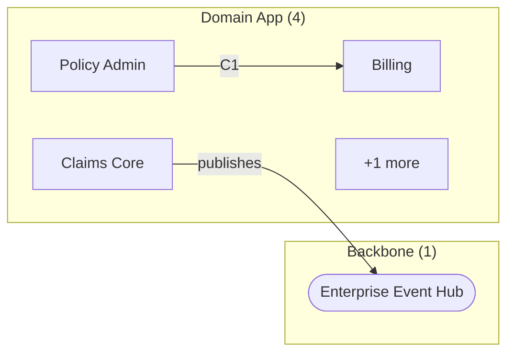
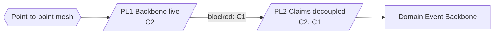

# PATTERN-04 — Mermaid viewpoint rendering

**Bundle:** PATTERN · **Package:** `adp.patterns.render` · **Depends on:** PATTERN-01 (PATTERN-02 for catalog, PATTERN-03 for conformance/transition) · **Status:** draft

## What

Pure functions that project a `PatternDefinition` (plus, optionally, a `ConformanceReport` or the catalog relations) into **Mermaid `flowchart` text**. There are five viewpoints. Output is deterministic, so it can be golden-file tested and diffed in PRs.

## Why

Mermaid is a **render target, never a source**: it carries no semantics to validate. One pattern needs several views (abstract structure, its state in the estate, migration progress, its place in the catalog), and all of them come from the same model. `flowchart` only, because ADP already renders Mermaid with the dagre layout.

## Functions — `adp/patterns/render.py`

```python
def render_structure(defn: PatternDefinition, opts: RenderOptions = ...) -> str
def render_conformance(defn: PatternDefinition, report: ConformanceReport, opts=...) -> str
def render_transition(defn: PatternDefinition, plateau: PlateauState | None, opts=...) -> str
def render_catalog(focus: PatternKey, nodes: list[PatternVersionSummary],
                   relations: list[PatternRelationRow], depth: int = 1, opts=...) -> str
def render_traceability(defn: PatternDefinition, principles: list[PrincipleRef],
                        controls: list[ControlRef], opts=...) -> str
```

`RenderOptions` (frozen, `extra="forbid"`): `direction: Literal["LR","TB"] = "LR"`, `max_elements_per_role: int = 8` (2–50), `include_legend: bool = True`, `include_theme_classes: bool = True`.

## Rendering rules (all views)

| Rule | Detail |
|---|---|
| **Header** | First line `%% adp-pattern <key>@<version> view=<view> digest=<first 12 chars>` — provenance, and lets the UI detect stale saved diagrams |
| **Node ids** | Deterministic and collision-free: roles `r_<role_key>`, elements `e_<role_key>_<n>` (n = position in sorted bindings), plateaus `p_<id>`, patterns `pt_<sha1(key)[:8]>`. Never use raw user text as an id |
| **Labels** | Always quoted `["…"]`. Escape `"` → `#quot;`, `<`/`>` → `#lt;`/`#gt;`; line breaks only via `<br/>`; truncate at 60 chars with `…` |
| **Shapes** | Role `["…"]`; role with stereotype `platform` or mediating (`via`) `(["…"])`; anti-pattern node `{{"…"}}`; plateau `[/"…"/]` |
| **Order** | Nodes in declared role order; edges in declared relationship order, then render-hint edges. No dict-iteration nondeterminism |
| **Edges** | Relationship: `A -- "type[: label]" --> B`. With `via`: two edges, `A --> V --> B`, and the label on the first. Render hint `prohibited_edge`: `A -. "label" .-x B`. `required_edge`: `A == "label" ==> B` |
| **Theme** | `classDef` set below, using the **locked C4 theme palette tokens** (WCAG-compliant). Do not invent new colours. Classes are applied with `class id1,id2 name;` at the end of the document |
| **Legend** | Optional `subgraph legend` listing only the classes used |

### Classes

| Class | Used for |
|---|---|
| `role` | Abstract role (structure view) |
| `mediator` | `via` / platform role |
| `pass` | Element with no error/warning findings |
| `warn` | Element in a warning finding |
| `fail` | Element in an error finding |
| `unknown` | Element in an `evaluation_error` / `field_unavailable` finding |
| `antipattern` | Anti-pattern nodes |
| `reached` / `pending` | Plateaus |

## Views

### 1. `structure` — the abstract template

Roles as nodes, with the label `«stereotype» Label<br/>cardinality`. Relationships and render hints as edges. This needs no registry data.



### 2. `conformance` — the pattern bound to real elements

One `subgraph` per role (title = role label + bound count). Inside it, the bound elements, coloured by their worst finding. If a role has more than `max_elements_per_role` elements, show the worst-first top N plus `+k more` (sort order: fail, unknown, warn, pass, then name). Edges come from snapshot evidence for the declared relationships and from offending integrations (red, labelled with the constraint id). The subgraph title gets a `⚠` suffix when an implicit `K:` finding failed for that role.



### 3. `transition` — the migration path

`from_pattern` (anti-pattern node) → plateaus in order → this pattern. Each plateau label lists its exit-criteria ids. Given a `PlateauState`, plateaus up to `reached` get the `reached` class and the rest `pending`; the edge into `next` is labelled `blocked: C3, C4`.



### 4. `catalog` — the pattern's neighbourhood

The focus pattern plus the patterns within `depth` hops (1–3) over `ea_pattern_relation`. Edge label = relation type. `conflicts_with` and `alternative_to` render as undirected dotted lines `-.-`. Anti-patterns use the `antipattern` class; `deprecated` versions get a `(deprecated)` label suffix.

### 5. `traceability` — why the pattern exists

Principles and controls → the pattern → its known implementations. Three columns, using `subgraph` with `direction TB` per column inside an LR flowchart. Unresolved references are rendered with the `unknown` class rather than dropped.

## Router — prefix `/api/v1/patterns`

| Method & path | Notes |
|---|---|
| `GET /{key}/versions/{version}/views/{view}` | `structure`, `catalog`, `traceability`; `transition` without state. Query params map to `RenderOptions` |
| `GET /adoptions/{id}/views/conformance` | Evaluates (PATTERN-03), then renders |
| `GET /adoptions/{id}/views/transition` | Evaluates, then renders with `PlateauState` |
| `POST /render` | Dry-run: body `{yaml, view}`, for draft authoring (structure/catalog only). Read-only allowlist entry |

Response: `PatternViewResponse{view, mermaid: str, digest, generated_at, truncated_roles: list[RoleKey]}`. **JSON, not `text/*`**: the metadata matters to the UI. Requesting a view not listed in the pattern's `views` is allowed (`views` is the default set shown in the UI, not a restriction).

## Tests

| Test | Asserts |
|---|---|
| `test_golden_<view>_<fixture>` | Output equals the committed `.mmd` golden files. Regenerate with `pytest --update-goldens` (developer flag; CI never updates) |
| `test_deterministic` | Rendering 50× (shuffled input lists where order isn't semantic) yields identical text |
| `test_label_escaping` | Quotes, brackets, `<script>`, emoji, 200-char names |
| `test_id_collision_free` | Role keys `a_b` + `a` with element counts that could collide produce unique ids |
| `test_collapse_worst_first` | Ordering of the top N plus a correct `+k more` count |
| `test_header_provenance` | Digest prefix matches |
| `test_mermaid_parse` (CI job `mermaid-lint`, optional) | Every golden parses with `@mermaid-js/mermaid-cli` pinned in `package.json`. Separate job so the Python suite has no Node dependency |

## Out of scope

`architecture-beta`, `block-beta`, `requirementDiagram`, `quadrantChart`; saving views into `adp.diagrams`; SVG/PNG export on the server; interactive click handlers; layout tuning beyond direction.

## Open questions

| # | Question |
|---|---|
| OQ-1 | Should rendered views be savable as `adp.diagrams` entries (snapshotted, with the provenance header used to flag staleness), or always live? |
| OQ-2 | Is `block-beta` worth a sixth view for capability-to-application placement, given it doesn't use dagre? |
| OQ-3 | Should the `mermaid-lint` CI job be required or advisory? It adds a Node toolchain to CI. |
| OQ-4 | Should the conformance view show compliant integrations as edges too, or only offenders (to reduce clutter on large domains)? |
